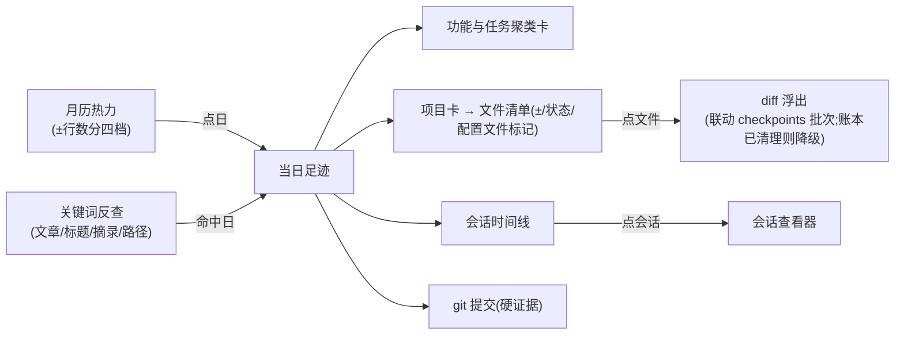

# 每日工作足迹(按日回溯改动与反查)调研

- 日期:2026-10-19
- 状态:调研完成,交互原型已产出(`docs/design/daily-work-footprint.html`),方案待确认
- 结论:做。市面上没有产品同时做到「按日回溯 + 改了哪些文件/多少行 + 关键词反查到某天」;tmd-cli 手里握有全市场独有的差异化数据——checkpoints 账本的「改动 → 会话」归因。唯一硬缺口是账本 30 天 TTL,方案必须新增一层按日落盘的 rollup 持久账,不能直接查 checkpoint 账本回两个月。

## 1. 场景定义

两个典型场景,交互都要接住:

- **场景 A(按日回溯)**:「两个月前某一天做了账号密码登录功能,涉及哪些工程代码/配置文件、改了多少」。入口是日期,诉求是文件级清单 + 改动量 + 归属会话。
- **场景 B(特征反查)**:「我记得做过账号密码登录,是哪天?」入口是关键词,诉求是反查到日,再落到场景 A。

现状(工作台每日日志)为什么不够:

| 缺口 | 事实 |
|---|---|
| 无量化 | 文章是散文体(AI 汇总),没有文件清单、±行数 |
| 热力无改动维度 | 月历热力按「当日会话数」分位分档(journalStore.heatOf),看不出改了多少东西 |
| 不可反查 | article/digest 按月散落 `~/.tmd-cli/daily/`,无检索面,「账号密码」搜不进去 |
| 跨日对比弱 | 一天一篇文章,两个月粒度只能逐篇翻 |

## 2. 竞品与相邻产品盘点

结论:能力分四派,每派只做了半件事。GitHub/WakaTime 有「定位到天」没有内容;会话历史查看器有「从词到天」的搜索但没有日子级聚合。热力定位与全文反查必须闭环,这正是空白点。

| 模式 | 代表 | 有什么 | 缺什么 |
|---|---|---|---|
| 日历热力型 | GitHub contribution graph、claudelytics | 强度一眼扫全年,点击当日浮层 | 只有事件计数/会话数,无文件无行数,与 AI 会话无关联 |
| 时间线流水型 | Claude Code `/resume`、Warp command history、ccexplorer | 单会话/单命令因果复盘 | 无日子级聚合,两个月前无法定位 |
| 日报摘要型 | WakaTime daily email、ccusage daily、日记型(Obsidian daily notes) | 每天/每周例行回顾 | 事过境迁不可检索,摘要粒度丢细节 |
| 搜索反查型 | claude-code-history-viewer 全文搜索、Warp command search | 关键词命中 | 无时间呈现,命中后缺「这天还干了什么」的扩散上下文 |

分产品要点(详细出处见 §6):

- **GitHub**:年历热力 + 当日浮层;Events API 只回 90 天;行数不可靠;无 AI 关联。
- **WakaTime/CodeTime**:日 → 项目 → 文件的时长条形图,任意历史日期可回看;但核心指标是时长不是改动,文件内容维度缺失。
- **Claude Code 生态**(`/resume`、ccusage、ccexplorer、claudelytics 等):全部本地 JSONL、无限回溯;ccusage 有按日 token 报表可区间查询;ccexplorer 有单会话内 tool-call 时间线;claudelytics 有活动热力图。共同缺陷:没有一个把「某天 + 改了哪些工程文件 + 行数」串起来。
- **Cursor**:dashboard 面向团队管理员(用量/活跃),个人无按日「干了什么」视图。
- **git 生态**:`git log --since/--until --numstat` 任意某天文件级清单精确可查,但纯 commit 时刻、未提交工作丢失、多仓库要逐个扫、无 AI 上下文。
- **日记型**:交互隐喻可借鉴——一天 = 一张可点开的卡片。

对 tmd-cli 的可借鉴点:GitHub 式月历热力 + 当日浮层;WakaTime 式项目维度横条;ccusage 式 since/until 区间汇总;历史查看器式全文反查并回跳当日;ccexplorer 式会话内时间线作二级页。

## 3. 数据可行性(tmd-cli 侧摸底实证)

### 3.1 数据源清单

| 数据源 | 粒度 | 位置/接口 | 保留期 | 对场景的价值 |
|---|---|---|---|---|
| 每日文章 article | 天 | `~/.tmd-cli/daily/article/YYYY-MM-DD.md` | 永久 | 语义层:「做了账号密码登录」就在这里 |
| 当日摘录 digest | 天 × 会话小节 | `~/.tmd-cli/daily/digest/YYYY-MM-DD.md` | 永久 | 反查的特征词来源(会话内容压缩,含时间/引擎/标题头) |
| 会话日索引 DaySessionRow | 天 × 会话 | `daySessions.groupByDay`(listSessions 扫描 + 活会话合并) | 跟随 CLI 会话文件,长期 | 时间线骨架:起止时刻/引擎/标题/工作区 |
| 日↔项目/任务派生 | 天 × 项目 | `dayLinks.dayProjectLinks / dayTaskLinks`(cwd 归一精确匹配) | 运行时派生 | 「那天主要在搞哪个工程」 |
| **checkpoints 账本** | 轮次 × 文件(path/additions/deletions/status) | 每工作区 sidecar `ledger.jsonl`,turn 行封口固化 ± | **仅 100 批 / 30 天**(CKPT_KEEP=100,CKPT_TTL_DAYS=30,面板挂载即自动 prune) | 文件级 ± 与「改动→会话」归因的唯一来源,核心短板 |
| git 提交 | 天 × commit | git2(git 插件已有仓库面,需补按日 log 原语) | 永久 | 硬证据层,不受账本清理影响 |
| 会话写入事件适配器 | 会话 × 文件事件 | `readSessionEdits`(omp/pi/codex/grok/opencode 已声明,cli-shared/sessionEdits 共享骨架) | 跟随 CLI 会话 JSONL | rollup 的补充信号(checkpoints events 归因同源) |

### 3.2 三个缺口与对策

1. **30 天 TTL(致命)**:checkpoints 账本默认保最近 100 批、超期 30 天清理(storage-audit 清理面也是这个口径)。两个月前的文件级 ± 已不存在。对策:**新增按日 rollup 持久层**——turn 封口(或 turnSettled 事件)时向 `~/.tmd-cli/daily/rollup/`(月文件或日文件,append-only JSONL)追加一行 `{day, cwd, sessionId, engine, file, additions, deletions, status, attribution}`。体积极小(纯数字+路径),与账本 diff 物理解耦,回溯永久。已清理账本的日子:± 数字保留,diff 深链降级为「账本已清理」态(原型已演示该态)。
2. **无按日跨工作区查询面**:checkpointList 只有 `(cwd, sessionId)` 键控。rollup 层天然按日组织,前端插件直接消费;git 按日 commit 需补一个只读 IPC 原语(`git_log_range(cwd, since, until)`,git2 通用能力,无 CLI 私有知识)。
3. **无全文检索面**:article/digest 是按月散落的 md。MVP 直接按月 fs 扫描 + 逐文件字符串匹配(fs_collect_files/fs_read_tail 原语都在);数据量(一天一文件)远不需要索引,先扫描后建索引。

### 3.3 归因口径(诚实呈现)

rollup 的每条改动按可信度分三档,UI 必须标注,不冒充精确:

- **events**(AI 写入事件流,editMarks/readSessionEdits 双信号):最可信,逐文件落到会话。
- **git**(窗口推断):mtime 窗口仲裁,并行会话可能误归,标「窗口推断」。
- **无归因**(账本缺席或 rollup 前的旧日子):只有会话/文章层,文件清单缺失,显示退化态。

## 4. 交互设计提案

推荐方案 = **月历热力(定位到天)+ 当日足迹三分区(看那天干了什么)+ 全文反查(从词回到天)**,三者闭环。原型:`docs/design/daily-work-footprint.html`(浏览器直接打开,含交互)。

### 4.1 信息架构

- **月历**:格底热力按当日 ±行数分四档(沿用 daily-journal 的蓝→绿→琥珀→红色阶语言),可切「会话数」口径;hover 出迷你摘要(项目数/文件数/±/会话数);点日进当日视图;月脚一行当月合计。
- **当日头**:日期 + 五枚统计 chip(会话/项目/文件/±/活跃时长),全部 tabular-nums。
- **功能与任务**:当日会话标题 + 文章段落聚类出的功能卡(如「账号密码登录」),一卡 = 一个可讲出口的成果,卡上带会话数/文件数/±,点开滚到相关文件。
- **项目卡**:每项目一张,文件按目录分组;每文件行:路径、新增/修改/删除状态、±双数字 + 比例条、「配置」徽标(非代码文件一眼认出)、归因档徽标;点行浮出 diff。
- **会话时间线**:按开始时刻纵排,引擎徽标 + 标题 + 时长 + ±,动作:打开会话/查看改动。
- **git 提交**:当日 commit 列表,作为不依赖 AI 数据的硬证据。
- **反查**:搜索态输入「账号密码」→ 按日分组的命中卡(命中来源分色:文章/会话标题/摘录/文件路径),点卡跳当日并高亮命中来源。
- **区间汇总**:起止两日点选,出区间条(各项目横条,WakaTime 式),回答「这两周账号模块改了多少」。

### 4.2 关键状态

| 状态 | 处理 |
|---|---|
| 无数据日 | 格子灰色,当日页显示空态引导(「这天没有会话记录」),不报错 |
| 账本已清理 | 文件行 ± 数字保留,diff 深链置灰 + 「账本已清理,± 为足迹账固化值」 |
| 归因缺失 | 旧日子(rollup 上线前)不显示文件分区,只显示会话 + 文章 + git 提交 |
| 扫描失败 | 部分引擎清单缺失沿用 journal 的示警 pill 口径,不静默当空 |

### 4.3 落点与边界(预描,供方案评审)

- 新插件 `src/plugins/footprint/`(中央 tab),经 `activate(ctx)` 注册;数据面复用 daySessions 扫描缓存与 dayLinks 派生,不自建第二套扫描。
- rollup 写入点:订阅 `turnSettled`(与 checkpoints 插件同事件),封口后组装当日增量追加落盘;写盘走 fs 原子写。历史回补:仅能回补账本未清理窗口(≤30 天),更早的日子诚实退化。
- 全文检索数据 = article/digest 文件,插件私有路径知识放插件侧;扫描是通用 fs 原语,不违架构铁律。
- 开放问题(带进方案评审):① rollup 月文件 vs 日文件的粒度;② 「活跃时长」口径(会话起止并集 vs prompt 间隔);③ 功能聚类是规则聚合(标题分词)还是复用生成会话补一段「当日功能清单」落进 article。

## 5. 风险

- **隐私**:「账号密码」这类特征词会进 digest/rollup/检索命中预览,落盘明文。缓解:rollup 只存路径与数字,不存内容;命中预览截断;后续可加敏感词遮蔽。
- **归因误判**:git 窗口推断在并行会话下可能错归,UI 必须保留 checkpoints 的「窗口推断」可信度标注,不静默洗白。
- **扫描性能**:两个月跨度的反查 = 60 个 md + 会话标题索引,量级无虞;月历热力聚合须走 rollup,不能每次现场扫账本。

## 6. 来源

- GitHub Events API(90 天/300 条上限):https://docs.github.com/zh/rest/activity/events
- ccusage(daily/session 报表,--since/--until):https://github.com/ryoppippi/ccusage
- claude-code-history-viewer(全文搜索):https://github.com/jhlee0409/claude-code-history-viewer
- ccexplorer(会话内时间线):https://github.com/escottalexander/ccexplorer
- claudelytics(活动热力图):https://github.com/Obrais-cloud/claudelytics
- Cursor 团队 Analytics:https://cursor.com/docs/account/teams/analytics
- Warp Command Search:https://docs.warp.dev/terminal/entry/command-search
- git-quick-stats:https://github.com/git-quick-stats/git-quick-stats
- WakaTime(AI 用量追踪):https://wakatime.com
